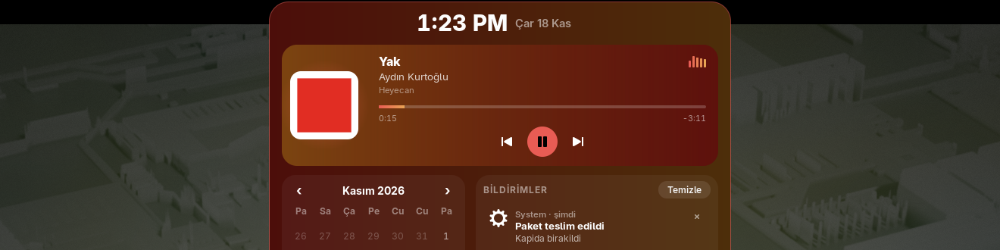
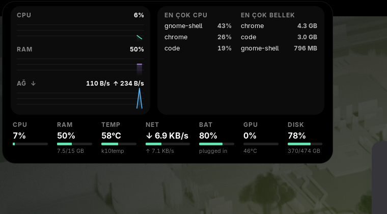
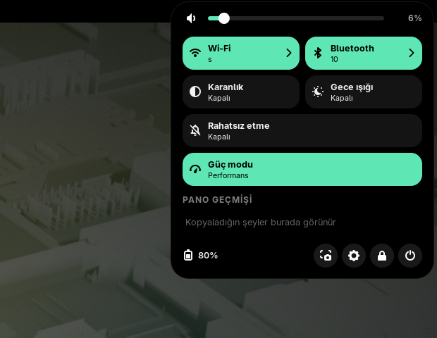
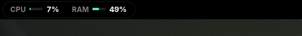
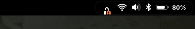
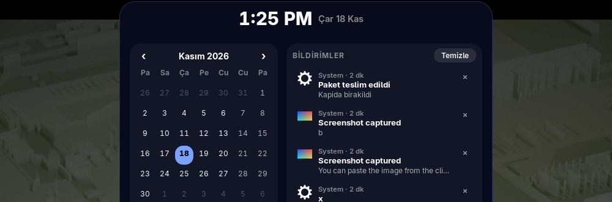

# Dynamic Island — GNOME Shell 50 eklentisi



| Sol island (istatistik) | Sağ island (Quick Settings) |
|---|---|
|  |  |

| Kapalı hâlleri | Tema | Olay |
|---|---|---|
|    |  |  |

*Ekran görüntüleri test ortamından (sahte oynatıcı, örnek veriler) alınmıştır.*

<!-- DEMO: docs/img/demo.gif (kısa ekran kaydı: hover ile açılma, müzik kartı, Quick Settings). Eklenince aşağıdaki satırı açın:

-->
> 🎞️ **Demo GIF'i için yer ayrıldı** — `docs/img/demo.gif` eklenince buraya konacak.

## English summary

**Dynamic Island** replaces three parts of the GNOME Shell 50 top panel (Activities, the clock, Quick Settings)
with black "pills" that expand when you hover over them. No clicking needed.

- **Left:** CPU / RAM / temperature / network / battery / GPU / disk, live graphs, top processes, workspaces.
- **Centre:** clock, music card (MPRIS, cover-art colours), calendar, notification list, search (Super+R),
  volume/brightness/notification/screenshot previews in the island.
- **Right:** Quick Settings (sliders, Wi-Fi/Bluetooth/power toggles, per-app volume, optional clipboard history).
- **Optional Claude Code integration:** notifications when Claude finishes or waits, optional Allow/Deny buttons,
  local usage estimate, and (opt-in) the real plan quota. See [Security and privacy](#güvenlik-ve-gizlilik).

GNOME Shell **50 only**. GPL-3.0. Install: `git clone https://github.com/10sinan/dynamic-island.git && cd dynamic-island && ./install.sh`,
log out and in once, then `gnome-extensions enable dynamic-island@10sinan.github.io`. Settings: Extensions app,
or `di-config` in a terminal. The rest of this document is in Turkish.


Üst panelde **üç siyah hap**. **Tıklama yok**: her şey üstüne gelince açılır, imleç çekilince kapanır.

```
[ sol: istatistik ]  (Activities yerine)     [ orta: saat + müzik ]     [ sağ: ses/Wi-Fi/pil ]
```

| | Panelde (kapalı) | Üstüne gelince |
|---|---|---|
| **Sol** (Activities'in yerine) | `CPU 8%  RAM 62%` (seçilebilir) | CPU, RAM, sıcaklık, ağ, pil, **GPU**, **disk** karoları · son 60 sn'nin **canlı CPU / RAM / ağ grafiği** · **en çok CPU ve bellek kullanan 3 uygulama** |
| **Orta** (saatin yerine) | saat, bildirim noktası, **müzik (kapak + equalizer)** | en üstte **büyük saat + tarih** · **müzik kartı** · **takvim** (ay görünümü, ‹ › ile ay değiştir, başlığa tıkla = bugün) · **bildirim listesi** (tıkla = aç, × = kapat, Temizle) |
| **Sağ** (Quick Settings) | Wi-Fi sinyali, ses, Bluetooth (bağlıyken), Rahatsız Etme (açıkken), pil + yüzde | **ses + parlaklık kaydırıcıları** · **düğmeler**: Wi-Fi ›, Bluetooth ›, Karanlık, Gece ışığı, Rahatsız etme, Uçak modu, Güç modu · **pano geçmişi** (son 10 kopya) · **pil + ekran görüntüsü, ayarlar, kilit, güç** (Uyku / Yeniden başlat / Kapat / Oturumu kapat) |

- **Super+A:** GNOME'un Quick Settings kısayolu (varsayılan `Super+A`, GNOME Ayarlar → Klavye'den değiştirdiysen o tuş) GNOME menüsü yerine **sağ island'ı** açar. Fare olmadan da açık kalır. Kapatmak için tekrar `Super+A`, `Esc` ya da island dışına tıklama yeter; dışarı tıklama yalnızca island'ı kapatır, alttaki pencereye geçmez. `shortcut-qs=false` ile GNOME'un menüsü geri gelir. Sağ island kapalıyken ya da tam ekranda kısayol yine GNOME'un menüsünü açar.
- **Sol island ve Activities:** Island, GNOME'un Activities düğmesinin yerini alır. Genel bakış yine **Super** tuşuyla (ve varsa hot corner ile) açılır. Düğmeyi geri istersen `di-config`'ten sol island'ı kapat: `stats-enabled=false`.
- **Wi-Fi ›:** island içinde yakındaki ağları listeler. Bir ağa tıklayınca bağlanır; şifreli yeni ağlarda şifreyi GNOME'un kendi penceresi sorar.
- **Bluetooth ›:** eşleşmiş cihazları listeler. Tıklayınca bağlanır ya da bağlantıyı keser.
- **Kaydırıcılar:** Sürüklerken imleç island'ın dışına çıksa da island açık kalır.
- **GNOME menüleri:** GNOME'un kendi takvim ve Quick Settings menüleri kullanılmaz; yalnızca klavye kısayolu (`Super+V`) ile açılırlar.
- **Sağ ikon satırı:** Menü çubuğu tarzında, Cairo ile çizilmiş özgün vektör ikonlar (`lib/glyphs.js`): Wi-Fi yelpazesi (sinyale göre 0-3 yay yanar, kapalıyken üstü çizili), dalgalı hoparlör (sessizde çarpı), Bluetooth, Rahatsız Etme ayı ve yuvarlak köşeli pil. Pilde doluluk yuvarlak bir dolgu olarak çizilir; %20 ve altında kırmızı, şarjdayken yeşil ve içinde şimşek vardır. Hepsi 16 px'lik aynı çizgide, eşit aralıkla durur. Bluetooth ve Rahatsız Etme yalnızca ilgiliyken görünür. Mikrofon, kamera, konum, ekran paylaşımı gibi nadir GNOME göstergeleri yalnızca görünür oldukları sürece eklenir. Hazır ikon seti kullanılmadığı için lisans sorunu yoktur.

### Müzik

Spotify, tarayıcılar (YouTube Music dahil), VLC, Rhythmbox gibi **MPRIS** destekleyen her oynatıcıyla çalışır:

- **Panelde:** Çalarken küçük kapak ve hareketli equalizer görünür. Müzik durunca ya da oynatıcı kapanınca kaybolur ve pill eski genişliğine döner.
- **Üstüne gelince:** Saatin altında kart açılır. Kapakta kapak, başlık, sanatçı, albüm, ilerleme çubuğu ve ⏮ ⏯ ⏭ düğmeleri vardır. İlerleme çubuğuna tıklayınca şarkıda o noktaya atlar.
- **Şarkıya göre renk:** Albüm kapağından **iki ayrı renk** çıkarılır (beyaz çerçeve gibi kenarlar yok sayılır; tek renkli kapakta ikinci renk komşu bir ton olur). Kart arka planı, ilerleme çubuğu, equalizer ve oynat düğmesi bu renklerle boyanır. Şarkı değişince renkler yumuşakça geçer, kapak çapraz solarak değişir.
- **Hareket:** Kart açıkken ve müzik çalarken arka plandaki renkler yavaşça akar, kapağın arkasındaki parıltı ve kapak hafifçe nabız atar, equalizer çubukları (5 adet, iki renkli) oynar. **Müzik çalarken island'ın gövdesi de albüm renginde iki renkli bir gradient'e dönüşür** (panelde, açıkken ve şarkı değişimi önizlemesinde), kenarı albüm renginde yanar; duraklayınca ya da müzik bitince 0,7 sn'de tema rengine geri döner. Duraklayınca her şey durur; kart kapalıyken hiçbir animasyon çalışmaz.
- **Şarkı değişince:** Island kısa süre (4 sn) kapak, başlık ve sanatçıyla açılır. `music-popup` ile kapatılabilir.
- Birden çok oynatıcı varsa çalan, yoksa en son çalan gösterilir.
- Kapaklar `file://` (yalnızca normal dosya) ya da `https://` adresinden alınır, en fazla 8 MB. `https` için yalnızca oynatıcının bildirdiği kapak adresi istenir, başka bir şey gönderilmez. Kapak adresini oynatıcı (tarayıcıda web sayfası) belirlediği için `http://`, yönlendirmeler ve yerel ağ adresleri (`localhost`, `192.168.x.x`, `10.x.x.x`, `.local` …) reddedilir; bunlarda kapak görünmez.
- `dynamic-music-pill` eklentisi dock'ta çalışmaya devam eder; ikisi birbirini etkilemez.

### Pano geçmişi

**Varsayılan olarak kapalıdır** (kopyaladığın her şeyi okuduğu için). Açmak: Ayarlar → Özellikler → *Pano geçmişi* ya da `di-config set clipboard-history true`.

Açıkken sağ island'da **son 10 kopya** listelenir (metin ve resim; resimler küçük resimle). Bir kayda tıklayınca **panoya geri konur**, sen istediğin yere kendin yapıştırırsın (otomatik yapıştırma yok: terminalde ve bazı uygulamalarda yanlış çalışır). Liste 5-6 satırdan uzunsa tekerlekle kayar, **Temizle** hepsini siler.

- **Yalnızca bellekte tutulur**, diske hiçbir şey yazılmaz; oturumu ya da eklentiyi kapatınca silinir. Ayar değiştirince (island'lar yeniden kurulurken) silinmez.
- Parola yöneticilerinin ve gizli bilgi servislerinin "bu gizli" işaretiyle (`x-kde-passwordManagerHint`, `org.freedesktop.Secret…`, `x-nspasswordmanager` vb.) kopyaladığı içerik hiç okunmaz. Bu işaret uygulamanın iyi niyetine bağlıdır: işaretlemeyen bir uygulamadan kopyalanan parola listeye girer.
- Aynı şeyi tekrar kopyalarsan yeni satır eklenmez, üste taşınır. Çok uzun metinler 20 000 karakterde, 8 MB'tan büyük resimler hiç kaydedilmez.
- `clipboard-history=false` (varsayılan) ile izleme tamamen durur ve bölüm kaybolur. Kurulu `gnome-clipboard` gibi bir pano eklentisiyle birlikte çalışır, ikisi birbirini etkilemez.

### Olay göstergeleri

Orta island, makinede bir şey olunca kısa süre kendiliğinden açılır (sinyallerle çalışır, polling yok):

| Olay | Gösterim |
|---|---|
| Şarj kablosu takıldı / çıkarıldı | `⚡ Şarj oluyor · %62` |
| Pil %20 ve %10'a düştü | `Pil düşük · %19 kaldı` (sarı / kırmızı) |
| Wi-Fi bağlandı / koptu | `EvAğı · Bağlandı`, `Bağlantı koptu` |
| Bluetooth cihazı bağlandı / ayrıldı | `Kulaklık · Bağlandı` (cihazın simgesiyle) |
| Mikrofon / kamera kullanılıyor | turuncu / yeşil nokta |
| CPU 90°C'yi geçti | `Sistem ısındı · CPU 92°C` (kırmızı) |
| RAM %90'ı geçti | `Bellek az · %93 dolu` |
| Disk (`/`) %95'i geçti | `Disk dolmak üzere · %97 dolu · 12 GB boş` |
| Caps Lock / Num Lock açıldı-kapandı | `AA · Caps Lock · Açık` (GNOME bunlar için hiçbir gösterge vermez) |
| Klavye düzeni değişti | `TR · Türkçe (Q)` |
| Toplantı modu açıldı / bitti | `Bildirimler susturuldu` / `Bildirimler yeniden açık` |
| Güç tasarrufu açıldı / kapandı | `Pil %19 · ekran ve işlemci kısıldı` |

Sıcaklık, bellek ve disk 10 saniyede bir okunur. Her uyarı eşik aşılınca bir kez gösterilir ve değer tekrar düşünce (85°C, %85, %92) yeniden kurulur. Başlangıçta ilk değerler yalnızca kaydedilir, olay üretilmez. Island o sırada açıksa (sen kullanıyorsan) olay gösterilmez. Hangi olayların açık olduğunu `di-config` → **Olaylar** sekmesinden seçersin.

Orta island ayrıca kısa süreli **etkinlikler** gösterir:
- **Ses / parlaklık:** tuşa basınca GNOME'un ortadaki kutusu yerine island `🔊 ▬▬▬▬── 64%` diye açılır. Tuş basılı tutulursa yeniden animasyon yapmadan yerinde güncellenir.
- **Bildirim önizleme:** yeni bildirim gelince island uygulama, başlık ve metinle açılır.
  - Önizlemenin kendisine tıklamak bildirimi açar; sağ tık önizlemeyi kapatır; üstüne gelince süre durur.
  - Rahatsız Etme ayarına uyar.
- Caps Lock, klavye düzeni gibi diğer OSD'ler ve tam ekrandaki değişiklikler GNOME'un kendi göstergesinde kalır.

- **Hover:** Üstüne gelince hemen, yaylanarak açılır. İmleç çekilince 150 ms sonra kapanır. İmleç yokken 5 sn sonra kendiliğinden kapanır.
- **Liquid glass:** Island gövdesi yarı saydam cam gibidir: arkası görünür, üstte hafif parlama ve ışıklı bir kenar çizgisi olur. Gücü `glass-strength` (0-100, varsayılan 60) ile ayarlanır; `0` eski düz siyah gövdedir. Müzik çalarken albüm renkleri de camın içinden görünür.
- **Liquid glass görünümü (`liquid-glass`, varsayılan KAPALI):** Yarı saydam gövde, üstü parlak 1 px gradyan kenar, hafif iç gölge ve ince dış gölge. Yalnızca stil; mevcut temalar ve albüm renkleri aynen çalışır (albüm rengi gövdeyi ve kenarı boyar). Açıkken `glass-strength`'i geçersiz kılar.
  - **Arka plan bulanıklığı (`liquid-glass-blur`, varsayılan KAPALI):** Yalnızca ada **açıkken** `Shell.BlurEffect` (BACKGROUND) eklenir, kapanınca `remove_effect` ile tamamen kaldırılır (kapalı ada siyah panelin üstündedir, bulanıklaştırılacak bir şey yok). Bilinen sınır: `Shell.BlurEffect` düz dikdörtgendir, açık adanın köşelerinde yuvarlak gövdenin dışında birkaç piksel de bulanık kalır. Dış gölge `St` `box-shadow`'u yerine Cairo ile çizilir, çünkü `St` yuvarlak köşenin dışına kare gölge basıyordu; iç gölge `box-shadow` ile denendi ama her karede yeniden üretildiği için hover animasyonunu ~3,7 kat yavaşlattı, bu yüzden kenar renk gradyanı + gövde gradyanı kullanıldı.
- **Ayarlar:** Hepsi `di-config` terminal arayüzünden değiştirilir ve **anında** uygulanır.
- **Gizlenme:** Tam ekran uygulamalarda panelle birlikte gizlenir. Etkinlikler ekranında görünür kalır.
- **Veri okuma:** Veriler `/proc`, `/sys` ve shell servisleri (Gvc, NetworkManager, GnomeBluetooth, PowerProfiles) üzerinden **asenkron** okunur; ana thread bloklanmaz.
- **Tasarım:** Tamamen özgündür; üçüncü taraf ikon ya da karakter kullanılmaz.

## Kurulum

Gereksinimler: **GNOME Shell 50**, `glib-compile-schemas` (Fedora: `glib2-devel`, Debian/Ubuntu: `libglib2.0-bin`), isteğe bağlı `python3` (`di-config` ve Claude hook'u için).

```bash
git clone https://github.com/10sinan/dynamic-island.git
cd dynamic-island
./install.sh        # şemayı derler; eklentiyi, di-config'i ve di-claude-hook'u ~/.local altına symlink'ler
# → oturumu BİR KEZ kapatıp tekrar aç (Wayland'da shell yeniden başlatılamaz)
gnome-extensions enable dynamic-island@10sinan.github.io
```

`install.sh` hiçbir dosyayı kopyalamaz, yalnızca symlink kurar; klasörü taşırsan ya da silersen eklenti de gider. Eklenti yolunda symlink olmayan bir klasör varsa hata verip durur. `~/.local/bin` PATH'te olmalıdır (aksi halde betik hatırlatır).

Sonraki **ayar** değişiklikleri için tekrar giriş gerekmez. Yalnızca **kod** değişince
tekrar giriş gerekir; GJS modülleri önbellekte tuttuğu için `disable`/`enable` yetmez.

## Ayarlar penceresi

GNOME **Uzantılar** uygulaması → Dynamic Island → ⚙ (ya da `gnome-extensions prefs dynamic-island@10sinan.github.io`): island'lar, dil, tema, vurgu rengi, özellikler, zamanlama ve modüllerin açılıp kapanması / sırası / panelde gösterimi. (Eklentinin ayar penceresinin görünmesi için eklenti dosyası ilk kez eklendiyse oturumu bir kez kapatıp açmak gerekir.) Aynı ayarlar terminalden de yapılabilir:

## Özelleştirme: `di-config`

```bash
di-config            # etkileşimli terminal arayüzü
```

| Tuş | İşlev |
|---|---|
| `↑` `↓` | gez |
| `←` `→` (`+` `−`) | sayıyı / seçimi değiştir |
| `Space` | aç/kapa, modülü göster/gizle |
| `Enter` | (renkte) `#rrggbb` gir |
| `Tab`, `1`–`5` | sekme: Genel · Zamanlama · Görünüm · Orta modüller · QS modülleri |
| `J` / `K` | modülü aşağı / yukarı taşı |
| `p` | (orta modüller) panelde de göster |
| `r` / `R` | seçili ayarı / hepsini varsayılana döndür |
| `q` | çık |

Komut satırından (betikler için):

```bash
di-config list
di-config set hover-expand-delay 0
di-config set leave-collapse-delay 150
di-config set center-modules cpu,ram,temp,net,battery
di-config set center-compact-modules cpu,ram,temp      # panelde görünenler
di-config set accent-color '#5ab8ff'
di-config reset                                       # hepsini varsayılana döndür
```

| Anahtar | Varsayılan | Anlamı |
|---|---|---|
| `center-enabled` / `stats-enabled` / `qs-enabled` | açık | orta / sol (istatistik) / sağ island |
| `expand-on-hover` | açık | üstüne gelince aç (tek açılma yolu) |
| `hover-expand-delay` | 0 ms | açılmadan önce bekleme |
| `leave-collapse-delay` | 150 ms | imleç çekilince kapanmadan önce bekleme |
| `auto-collapse` | 5000 ms | imleç yokken kendiliğinden kapanma (0 = asla) |
| `animation-duration` / `spring` | 420 ms / açık | açılma animasyonu, yaylanma |
| `poll-compact` / `poll-expanded` | 2000 / 1000 ms | veri yenileme aralığı |
| `center-modules` | music, calendar, notifications | orta island içeriği (müzik kartı saatin altında, takvim/bildirimler yanyana) |
| `center-compact-modules` | music | saatin yanında panelde görünenler |
| `stats-modules` | cpu, ram, temp, net, battery, gpu, disk, graph, procs | sol island içeriği |
| `stats-compact-modules` | cpu, ram, disk | sol pill'de panelde görünenler |
| `events` | power, battery-low, wifi, bluetooth, privacy, thermal, memory, disk, lockkey, layout, meeting, powersaver | island'ı kısa süre açan olaylar |
| `language` | tr | arayüz dili: `tr` (Türkçe) ya da `en` (English). Cihazın diline **bağlı değildir**; yalnızca buradan değişir |
| `theme` | ink | `ink`, `midnight`, `sunset`, `forest`, `rose` |
| `accent-color` | boş | vurgu rengi (#rrggbb); boş = temanın rengi |
| `clipboard-history` | açık | son 10 kopyayı bellekte tut, sağ island'da göster |
| `meeting-mode` | açık | mikrofon/kamera kullanılırken Rahatsız Etme |
| `auto-power-saver` / `auto-power-saver-level` | açık / 20 | düşük pilde Güç Tasarrufu / pil yüzdesi eşiği |
| `shortcut-qs` | açık | Super+A (GNOME'un Quick Settings kısayolu) sağ island'ı açar |
| `screenshot-preview` | açık | ekran görüntüsü küçük resmi (bildirim önizlemeye bağlı) |
| `layout-version` | 2 | iç kullanım: eski kayıtlı listelerin otomatik taşınması |
| `qs-modules` | sliders, toggles, clipboard, system | sağ island bölümleri (yukarıdan aşağı) |
| `show-seconds` | kapalı | island saatinde saniye |
| `osd-enabled` | açık | ses/parlaklık göstergesi island'da |
| `music-popup` | açık | şarkı değişince kısa önizleme |
| `notification-preview` | açık | bildirimler island'da |
| `notification-duration` | 5000 ms | önizleme süresi (kritik bildirimler en az 10 sn) |

## Bilinen sınırlamalar

- **Yalnızca GNOME Shell 50.** `metadata.json` başka sürüm içermez; `addTopChrome`, OSD ve overview'un özel alanları gibi dahili API'ler sürümler arasında değişir.
- **Yalnızca ana monitör:** island'lar birincil monitörün panelinde durur.
- **Panel öğelerine bağımlılık:** saat, Quick Settings ve Activities düğmeleri gizlenir (silinmez); bu düğmeleri değiştiren başka eklentilerle çakışabilir.
- **Özel/dahili API'ler:** arama (`Main.overview` içi), `panel.toggleQuickSettings` yaması, OSD ve bildirim balonu yönlendirmesi GNOME güncellemesinde kırılabilir; kırılınca ilgili özellik GNOME'un kendi davranışına döner.
- **Kod değişince oturum kapatıp açmak gerekir** (Wayland'da shell yeniden başlatılamaz); yalnızca ayar değişiklikleri anında uygulanır.
- **Claude kartı bir tahmindir** (yerel kayıtlardan); gerçek kota belgelenmemiş bir adrese dayanır ve her an çalışmayabilir.
- **Açık ajan listesi** Claude Code'un hangi terminalleri açık tuttuğunu bilmez; kapatılmış oturum 30 dk "boşta" görünebilir.
- **Pano geçmişi** yalnızca metin ve PNG alır; "gizli" işaretini göndermeyen uygulamaların kopyaları listeye girer.
- Arayüz Türkçe ve İngilizce'dir.

## Güvenlik ve gizlilik

Eklenti kendi makinende çalışır ve varsayılan olarak **hiçbir veriyi internete göndermez**. Ağ kullanan ya da başka uygulamaların dosyalarına dokunan her şey aşağıda:

| Ne | Ne okur / nereye gider | Varsayılan |
|---|---|---|
| **Claude gerçek kotası** | `~/.claude/.credentials.json` içindeki giriş anahtarını okur, `https://api.anthropic.com/api/oauth/usage` adresine gönderir (başka hiçbir yere; yönlendirme izlenmez). **Bu adres belgelenmemiştir.** Anahtar kaydedilmez ve loglanmaz. Başarısız olursa özellik kendini kapatır (kurallar yukarıda). Kod tek bir dosyada yalıtılmıştır: `lib/claudeRealQuota.js`. | **Kapalı**; açarken onay penceresi |
| **Pano geçmişi** | Kopyaladığın metin/PNG'yi son 10 kayıt olarak yalnızca bellekte tutar, diske yazmaz. Parola yöneticisi işaretli kopyalar atlanır. | **Kapalı** |
| **Claude kullanım kartı / ajan paneli** | `~/.claude/projects/**/*.jsonl` oturum kayıtlarını **yerelde** okur (komut, dosya adı ve son isteğin metni ekranda görünebilir); hiçbir şey dışarı gitmez. Ajan paneli: `claude-agents-panel`. | Açık |
| **Müzik kapağı** | Oynatıcının verdiği `file://` ya da `https://` adresinden kapak indirir. https için ad önce çözülür ve yerel/özel ağa çıkan adresler reddedilir; yönlendirme izlenmez, 8 MB sınırı vardır. | Açık |
| **Claude bildirim köprüsü** | `tools/di-claude-hook` → yerel D-Bus nesnesi `/org/gnome/Shell/Extensions/DynamicIsland` → island. Aynı kullanıcının başka süreçleri de bu nesneyi çağırabilir: istekler hız sınırlıdır (20 patlama, saniyede 5), izin düğmeleri hiçbir şeyi kendiliğinden onaylamaz. | Bildirim açık, izin düğmeleri **kapalı** |

**Hook'ta sır maskeleme en iyi çabadır.** `di-claude-hook`, Claude Code'un araç girdilerini (komutlar, mesajlar) D-Bus'a ve island'a göndermeden önce bilinen kalıplarla maskeler: `Authorization:`/`Bearer` değerleri, `--password`/`--token`/`--secret`/`--api-key` bayrakları, `password=`/`token=`/`api_key:` atamaları, URL içi `kullanıcı:parola@`, `curl -u`, `sk-ant-…`, `ghp_…`/`github_pat_…`, AWS anahtar kimlikleri, Slack/GitLab belirteçleri ve JWT'ler `*****` olur (yalnızca değer; komutun kalanı okunur kalır). Bu **kalıp eşlemesidir, garanti değildir**: tanınmayan biçimdeki ya da adı belli olmayan bir sır maskelenmeyebilir. Ekran paylaşırken ya da hassas işlerde izin düğmelerini ve ajan panelini kapalı tut.

Eklenti `eval` ya da gizlenmiş kod içermez; alt süreç olarak yalnızca Ayarlar uygulamasını (`gnome-control-center`) açar.

### Güvenlik açığı bildirme

Bir güvenlik sorunu bulursan lütfen **herkese açık bir issue açma**. GitHub'ın özel bildirim özelliğini kullan:
depoda **Security** sekmesi → **Report a vulnerability** → formu doldur. Bildirim yalnızca depo sahibine görünür.
Ne olduğunu, nasıl yeniden üretileceğini ve etkilediği sürümü yazman yeterli. (Bu seçenek görünmüyorsa depo
ayarlarında *Private vulnerability reporting* henüz açılmamış demektir; o zaman normal bir issue ile yalnızca
"özel iletişim istiyorum" yaz, ayrıntıyı yazma.)

## Nasıl çalışıyor?

### Panel yerini alma (`lib/panelSlot.js`)

Saat (`dateMenu`), Quick Settings ve Activities düğmeleri **silinmez**:

- Görünmez yapılırlar (`opacity 0`), ama panelde kalıp yer kaplamaya devam ederler.
- Kapladıkları genişlik island'ın genişliğine ayarlanır. Böylece paneldeki diğer öğeler island'ın altına kaymaz.
- Menüleri (takvim, Quick Settings) ve kısayolları (`Super+V`, Super ile genel bakış) aynen çalışır.
- `disable()` opaklığı ve doğal genişliği geri verir.

### Toplantı modu

Mikrofon ya da kamera kullanılmaya başlayınca (Meet, Zoom, Teams, sesli arama, kayıt) **Rahatsız Etme otomatik açılır**, bırakılınca 10 saniye sonra eski haline döner. Kurallar:

- 2 saniye beklenir; mikrofonu kısa süre deneyince açılmaz. Aramadaki kısa kesintilerde de hemen kapanmaz.
- Rahatsız Etme zaten açıksa dokunulmaz ve asla kapatılmaz.
- Arama sırasında Rahatsız Etme'yi kendin kapatırsan eklenti karışmaz.
- Eklentinin açtığı bilgisi ayarlarda saklanır; oturum ortasında çökme ya da çıkış olursa bir sonraki açılışta geri alınır. Eklentiyi kapatmak da hemen geri alır.
- `meeting-mode=false` ile tamamen kapatılır.

### Otomatik güç tasarrufu

Pil %20'nin (ayarlanabilir) altına düşünce ve şarjda değilken `power-profiles-daemon`'dan **Güç Tasarrufu profili istenir** (`HoldProfile`). Bu bir "tutma"dır: bıraktığında daemon kendiliğinden önceki profile döner, eklentinin geri yüklenecek bir durum tutması gerekmez. Şarja takınca, eklenti kapanınca ya da süreç ölünce bırakılır. Profili kendin değiştirirsen daemon tutmayı bırakır ve eklenti bir sonraki şarja kadar tekrar istemez.

### Disk hızı göstergesi

Diskte iki ölçüm üst üste yüksek okuma+yazma (≥50 MB/s) görünce sol pill'de küçük bir disk simgesi ve toplam hız (`190 MB/s`) belirir ve island `Büyük dosya işlemi · ↓ 100 MB/s ↑ 90 MB/s` diye kısa süre açılır. Hız 20 MB/s'nin altına inince `Dosya işlemi bitti · 12.4 GB aktarıldı` der. Açık island'ın DISK karosunda da canlı hız görünür. **Yüzde ve kalan süre yoktur:** işletim sistemi işlemin toplam boyutunu bildirmez (Nautilus 50 ilerlemeyi yalnızca kendi penceresinde gösterir, dışarıya sunmaz). USB bellek, SD kart ve NVMe/SATA diskler sayılır; bölümler ve sanal cihazlar (loop, dm, zram) hariç.

### Dil (Türkçe / English)

Arayüz dili cihazın diline göre **değil**, `language` ayarına göre belirlenir (varsayılan `tr`). `di-config` → Genel → **Dil / Language** ile ya da `di-config set language en` ile değişir; island'lar ve `di-config` arayüzü anında yeni dile geçer. Tarih/ay/gün adları ve takvimin hafta başlangıcı da dile bağlıdır (Türkçe: Pazartesi, English: Sunday). Yeni dil eklemek için `lib/i18n.js` içindeki tabloya (İngilizce metin → çeviri) ve `tools/di-config` içindeki `EN` sözlüğüne bakın.

### Çalışma alanları, ses çıkışı, uyanık tut

- **Çalışma alanları (sol island):** Her çalışma alanı bir kart; içindeki pencereler listelenir. Pencereye tıkla → o pencereye geçer, başlığa tıkla → o çalışma alanına geçer (Activities düğmesinin yerini tutar).
- **Ses çıkışı (sağ island):** Birden fazla çıkış varsa (hoparlör, kulaklık, Bluetooth, HDMI) listelenir; tıklayınca varsayılan çıkış olur.
- **Uyanık tut (sağ island, düğmeler):** Ekranın kararmasını ve uykuya geçmeyi engeller. Her tıkta: 30 dk → 1 sa → 3 sa → kapatana kadar → kapalı. Açıkken panelde küçük bir güneş simgesi görünür.
- **Disk bildirimi:** "Büyük dosya işlemi" artık yalnızca yaklaşık 10 sn boyunca sürekli ~150 MB/s üstü disk kullanımında çıkar, 2 dakikada en fazla bir kez; biten işlem için de en az 2 GB taşınmış olmalıdır.

### Claude Code kullanımı (orta island)

Orta island'da **CLAUDE** kartı: 5 saatlik oturumda kullanılan token ve oturumun ne zaman sıfırlanacağı. Veri, bu bilgisayardaki `~/.claude/projects/**/*.jsonl` kayıtlarından **tahmin edilir**; hiçbir şey internete gönderilmez, hesap bilgin/token'ın okunmaz. Anthropic planındaki kalan kotayı yerelde yayımlamadığı için "kalan" bir limite göredir: ayarlardan **Claude token limiti** (bin token) girersen kalan yüzde görünür (örn. `di-config set claude-token-limit 20000` = 20M). Hesap yalnızca girdi + çıktı + önbellek yazma tokenlarını sayar, önbellek okumayı saymaz; resmî `/usage` ekranıyla birebir aynı değildir (Anthropic limiti farklı ağırlıklarla sayar ve yüzdeyi yerelde yayımlamaz).

**Gerçek kota (isteğe bağlı, varsayılan KAPALI):** `claude-real-usage` açıksa kart, Claude Code'un `/usage` ekranındaki rakamların aynısını gösterir: **5 saat** ve **haftalık** (varsa model bazlı haftalık) satırları; her satırda turuncu çubuk, yüzde ve sıfırlanma (`4,7 sa (Per 01:30)`). Bunun için Claude Code'un `~/.claude/.credentials.json` dosyasındaki giriş anahtarı **yalnızca okunur** ve yalnızca `api.anthropic.com`'a gönderilir (yenilenmez, değiştirilmez, kaydedilmez, loglanmaz); aralık en az 1 dakikadır, island açıkken 3 dakikada bir güncellenir. Ayarlar penceresinde açarken ne okunduğunu söyleyen bir **onay penceresi** çıkar. Kapanma kuralları:

- Giriş dosyası yoksa/okunamıyorsa ya da Anthropic **401/403** derse özellik hemen kapanır (`claude-real-usage` yeniden `false` olur, sessizce).
- Ağ/sunucu (5xx, zaman aşımı) hatalarında art arda **3** başarısızlıktan sonra kapanır; başarılı bir istek sayacı sıfırlar.
- Anahtarın **süresi dolmuşsa** kapanmaz: istek atılmaz, son değerler kalır, dosya sonraki yoklamada yeniden okunur (Claude Code çalışınca yeniler).

Bu adres (`/api/oauth/usage`) **resmî olarak belgelenmemiştir** ve haber verilmeden değişebilir ya da kalkabilir; o durumda özellik yukarıdaki kurallarla kapanır ve kart yerel tahmine döner. Açmak: `di-config set claude-real-usage true` (onay penceresi yalnızca ayarlar penceresinde çıkar) ya da Ayarlar → Claude.

**Açık ajanlar (üstüne gelince):** Claude kartının üstünde imleci kısa süre (~0,2 sn) tutunca kartın altında bir panel açılır; imleç çekilince kapanır. Kartın başlığında ayrıca `2 ajan` rozeti görünür. Panelde son 30 dakikada hareket eden her Claude Code oturumu (en fazla 6) için:
- **proje adı** (çalışma klasörünün adı), durum noktası (turuncu = çalışıyor, gri = boşta) ve `çalışıyor` / `12 dk önce`,
- **şu an ne yaptığı**: çalışan araç ve hedefi (`Bash · npm test`, `Edit · lib/x.js`), ya da Claude'un son yazdığı cümle; araç yanıt beklerken "çalışıyor" kalır,
- Task aracıyla başlatılmış bir **alt ajan** çalışıyorsa `↳ Alt ajan çalışıyor`,
- oturumda en son yazdığın istek (soluk).

Her şey yerel oturum kayıtlarından (`~/.claude/projects`, kota için zaten okunan dosyalar) okunur; hiçbir şey dışarı gönderilmez. **Bu bir tahmindir:** Claude Code hangi terminallerin hâlâ açık olduğunu bildirmez; kapatılmış bir oturum son hareketinden 30 dakika sonrasına kadar "boşta" görünür. Komut ve dosya adları ekranda göründüğü için ekran paylaşırken kapatmak istersen: `di-config set claude-agents-panel false` ya da Ayarlar → Özellikler. Dosya içerikleri ve araç çıktıları hiçbir zaman gösterilmez.

**Kalibrasyon (yerel tahmin için):** Claude Code'da `/usage`'ın gösterdiği oturum yüzdesini bir kez gir; limit, yerelde sayılan tokenlarla o yüzde eşleşecek şekilde ayarlanır:

```bash
di-config claude-calibrate 37      # ya da: Ayarlar penceresi → Özellikler → "Kalibre et"
```

### Arama (Super+R)

**Super+R** orta island'da bir arama kutusu açar: uygulamalar, dosyalar (Dosyalar/Nautilus), ayarlar, hesap makinesi ve arama sağlayıcısı olan diğer uygulamalar — GNOME'un genel bakış aramasının kullandığı aynı sağlayıcılar. Yazdıkça sonuçlar gelir; ↑/↓ (ya da Tab) seçer, Enter açar, Esc ya da tekrar Super+R kapatır. Kısayol `shortcut-search` ayarıyla değiştirilebilir (örn. `di-config set shortcut-search "['<Super>space']"`).

### Sağ island

Düğmeler koyu cam kartlar; açık olanın simgesi vurgu renginde bir dairede. Wi-Fi ve Bluetooth ›  sayfası island'ın tamamını kaplar (ses, pano ve sistem bölümleri o sırada gizlenir), sağdan kayarak açılır: üstte geri düğmesi + aç/kapa anahtarı, "Bağlı ağ / Diğer ağlar" (Bluetooth: "Bağlı / Cihazlarım") bölümleri, kayıtlı/güvenli/açık ağ bilgisi, bağlanırken dönen gösterge, bağlı Bluetooth cihazında pil yüzdesi, en altta "Diğer ayarlar…" (GNOME Ayarlar'ın ilgili sayfası).

### Claude Code bildirimleri

Claude Code **bir işi bitirince** ya da **senden izin/yanıt beklerken** orta island bildirim gibi büyür; kenarında **turuncu, dalgalı, hareketli bir çizgi** döner (beklerken daha hızlı). Claude'un çalıştığı pencere (VS Code / terminal) zaten öndeyse ya da Rahatsız Etme açıksa gösterilmez. Tıklayınca o pencere öne gelir, sağ tık kapatır.

Claude'a bir mesaj gönderdiğinde panel hapında **küçük turuncu bir dalga + proje adı** belirir (birden çok oturum varsa `proje +1`); Claude bitince dalga kaybolur ve bildirim açılır.

Bir kez kurulum (Claude Code'un kendi hook özelliğini kullanır, `~/.claude/settings.json`'a üç girdi ekler, önce yedek alır):

```bash
ln -sfn "$PWD/tools/di-claude-hook" ~/.local/bin/di-claude-hook   # install.sh bunu zaten yapar
di-config claude-hooks install    # kaldırmak: di-config claude-hooks remove · durum: status
```

Akış: Claude Code → `tools/di-claude-hook` → yerel D-Bus (`/org/gnome/Shell/Extensions/DynamicIsland`) → island. İnternete hiçbir şey gitmez; betik her koşulda anında çıkar, Claude'u bekletmez. Kapatmak için ayar: `claude-notify`.

### Claude kota uyarısı

`claude-real-usage` açıkken arka planda 5 dakikada bir kota okunur; 5 saatlik ya da haftalık kullanım **%80** ve **%95**'i geçince island bir kez uyarır (`Claude · 5 saatlik limit %83 · 4,7 sa sonra sıfırlanır · Haftalık %44`), pencere sıfırlanana kadar aynı eşik tekrarlanmaz. Kabuk açılırken zaten geçilmiş bir eşik için uyarı çıkmaz. Rahatsız Etme açıkken gösterilmez. Ayar: `claude-quota-alerts`.

### Claude izin düğmeleri (İzin ver / Reddet)

Claude Code bir araç için izin isterken (örn. `Bash: git push origin main`) island'da komut özetiyle birlikte **Reddet / İzin ver** düğmeleri çıkar. Claude Code'un `PermissionRequest` hook'unu kullanır.

Güvenlik tasarımı:
- Ayar **varsayılan kapalı** (`claude-permission-buttons`); `di-config claude-hooks install` ek olarak bu hook'u da kurar.
- **Hiçbir şey kendiliğinden onaylanmaz.** İzin yalnızca düğmeye fare tıklamasıyla verilir (Enter/klavye yok). Cevap vermezsen, island kapanırsa, zaman aşımına uğrarsa, eklenti kapalıysa ya da hata olursa hook hiçbir şey yazmaz ve Claude Code **normal izin penceresini** gösterir (test: `tests/claudepermission.test.py`).
- Claude'un penceresine zaten bakıyorsan ya da Rahatsız Etme açıksa düğmeler çıkmaz; normal pencere gelir.
- **Göremediğin şeye izin verilmez.** Island'da düğmeler yalnızca isteğin tamamı gösterilebiliyorsa çıkar: Bash komutu 120 karakterden uzunsa ya da araç özetlenemiyorsa (MCP araçları, Task, Glob…) island'a hiç sorulmaz, karar Claude Code'un kendi penceresinde verilir ("Claude seni bekliyor" bildirimi yine gelir). Gösterilen komut tek satıra kısaltılmaz, satırlara sarılarak tamamı görünür.
- Edit / Write gibi dosya araçlarında yalnızca dosya yolu gösterilir, değişikliğin içeriği gösterilmez. İçeriği görmek istiyorsan Claude Code'un penceresinden onayla.
- Birden çok istek sırayla gösterilir; ekrandakinin arkasında en fazla 8 istek bekler, fazlası Claude Code'un penceresine gider.
- Başka bir yerel süreç D-Bus'a sahte istek gönderebilir ama **izin veremez**: onay yalnızca bekleyen hook çağrısına, tıklamayla döner.

Kurulum: `di-config claude-hooks install` ve `di-config set claude-permission-buttons true`.

### Uygulama başına ses

Sağ island'da ses çalan her uygulama (tarayıcı, Spotify, Discord...) için ayrı kaydırıcı; simgeye tıklayınca o uygulama sessize alınır. Hiçbir uygulama ses çalmıyorsa bölüm gizlenir.

### Pil simgesi

Bilgisayar prizdeyken pil simgesi yeşil ve şimşekli olur — şarj sınırı (örn. ASUS %80) yüzünden pil "şarj olmuyor" görünse bile; sistem satırında "prizde" yazar.

### Temalar

`di-config` → Görünüm → **Renk teması**: Mürekkep (siyah, varsayılan), Gece mavisi, Gün batımı, Orman, Gül. Tema island'ın zeminini, kenarını (üstüne gelince parlar) ve varsayılan vurgu rengini birlikte değiştirir. **Vurgu rengini** ayrıca elle seçersen o, temanın rengini ezer; "tema rengi" seçeneği temanınkine döner. Müzik çalarken kenar albüm renginde yanmaya devam eder.

### Eski ayarların taşınması

Daha önce `di-config` ile kaydedilmiş `center-modules` / `center-compact-modules` listeleri varsayılanı ezdiği için, eklenti ilk açılışında `cpu, ram, temp, net, battery` kimliklerini bu listelerden **sol island'ın listelerine taşır** (sıran ve seçimlerin korunur), sonra `layout-version=2` yazar. Yeni modüller (GPU, disk, grafik, süreçler) sol island'a eklenir.

### Grafikler

`lib/history.js` zaman damgalı örnekleri tutar, `lib/graph.js` onları Cairo ile çizer. CPU, RAM ve ağ modülleri island kapalıyken de örnek toplar (yalnızca birkaç dosya okuması), böylece grafik açılınca zaten dolu gelir. Çizim yalnızca island açıkken yapılır. Süreç listesi `/proc/<pid>/stat` dosyalarını yalnızca island açıkken, asenkron ve 24'erli gruplar halinde okur; aynı adlı süreçler (bir tarayıcının onlarca süreci) tek satırda toplanır.

### Akıcılık

Animasyon sırasında hiçbir içerik yeniden yerleşmez:

- **Hareket eden tek parça:** Yalnızca içi boş siyah arka plan (`bg`) büyüyüp küçülür.
- **İçerik:** Saat, karolar, OSD ve bildirim zaten son konumlarında durur; yalnızca solup belirir ve `bg`'nin dikdörtgenine göre kırpılır.
- **Fare alanı (hitbox):** Bir açılma/kapanmada yalnızca 1 kez boyut değiştirir. Önceden her karede değişiyordu ve shell her karede input bölgesini yeniden hesaplıyordu.
- **Köşeler:** Yarıçap her karede `min(26 px, yükseklik/2)` olarak hesaplanır, bu yüzden köşeler hiçbir karede bozulmaz.
- **Gölge yok:** Island'ların arkasında gölge yok (hem görünüm hem performans için).
- **Çubuklar:** Seviye çubukları genişlik yerine `scale_x` ile anime edilir.
- **Veri yenileme:** Kapalıyken yalnızca panelde görünen modüller yenilenir. Açılınca veri yenilemesi animasyon bitince yapılır.
- **Hover histerezisi (titreme önleme):** İmleç adanın üstünde en az 60 ms durmalı (üstünden geçip gitmek hiçbir şey açmaz; kapanırken hâlâ büyükse anında yeniden açılır). Açık ada kenarının 8 px dışına kadar hover sayılır (görünmez bir pay). Yeni açılan ada 250 ms'den önce kapanmaz; kenarda titreyen el (kısa sürede tekrar çıkış) kapanma bekleyişini en çok 3 katına uzatır. Senaryolar: `tests/headless-hover.sh`.
- **Animasyon tablosu:** Tüm süreler ve easing'ler `lib/constants.js` içindeki tek tabloda (belirme, kaybolma, kayma, pop, süzülme, renk...); aynı türdeki animasyonlar aynı değeri kullanır.
- **Görünmeyen çizilmez:** Gizli bir karodaki metin/çubuk güncellenmez (görününce en yeni değer yazılır); görünmeyen equalizer ve Claude dalgası durur (dalganın zaman çizgisi artık gizliyken duraklatılır).

### Ayar değişince

Eklenti GSettings'i dinler. Bir ayar değişince 150 ms bekler, island'ları sızıntısız biçimde yıkıp yeniden kurar.

## Klasör yapısı

```
install.sh                 # kurulum
tools/di-config            # terminal arayüzü + CLI (Python, curses; ek bağımlılık yok)
dynamic-island@10sinan.github.io/
├── metadata.json
├── prefs.js               # GNOME Uzantılar uygulamasındaki ayar penceresi (Adwaita)
├── extension.js           # ayarları okur, island'ları kurar, değişince yeniden kurar
├── stylesheet.css
├── schemas/               # GSettings şeması (install.sh derler)
├── lib/
│   ├── island.js          # bir island: aktörler, konum, morph animasyonu, etkinlikler, hover/tık, polling
│   ├── osd.js             # ses/parlaklık OSD'sini island'a yönlendirir
│   ├── notifications.js   # bildirim önizleme (GNOME balonu ekran dışına alınır)
│   ├── events.js          # olay göstergeleri (şarj, pil, Wi-Fi, Bluetooth, mikrofon/kamera)
│   ├── claudeRealQuota.js # gerçek Claude kotası: tek yalıtılmış servis (kapanma kuralları)
│   ├── history.js graph.js# canlı grafikler için örnek tamponu + Cairo çizimi
│   ├── clipboardStore.js  # pano geçmişi (bellekte), clipList.js: liste mantığı
│   ├── glyphs.js          # sağ ikon satırının Cairo ile çizilmiş ikonları (glyphLogic.js: seviye/renk kararları)
│   ├── color.js           # albüm kapağından renk çıkarma (saf fonksiyonlar)
│   ├── panelSlot.js       # panel düğmesini gizler, yerini ayırır, menüsüne erişim
│   ├── settings.js        # GSettings → config
│   ├── disposer.js        # sinyal / timeout / cancellable temizliği
│   ├── proc.js            # async dosya okuma + parser'lar
│   ├── widgets.js         # Meter / LevelBar
│   └── constants.js
└── modules/
    ├── base.js            # IslandModule sözleşmesi
    ├── index.js           # kayıtlar: CENTER_MODULES, QS_MODULES
    ├── clock.js music.js calendar.js notificationList.js cpu.js ram.js temp.js net.js battery.js
    ├── stats/ graph.js gpu.js disk.js procs.js
    └── qs/ status.js sliders.js toggles.js system.js
tests/
├── proc.test.js           # parser + canlı /proc okuma (gjs)
├── color.test.js          # renk çıkarma + palet testleri (gjs)
├── history.test.js        # grafik örnek tamponu testleri (gjs)
├── diskio.test.js         # disk hızı ölçer testleri (gjs)
├── glyphs.test.js         # ikon seviye/renk kararları testleri (gjs)
├── cliplist.test.js       # pano geçmişi listesi testleri (gjs)
├── i18n.test.js           # dil katmanı testleri (gjs)
├── spring.test.js         # yay fiziği testleri (gjs)
├── claudeusage.test.js    # Claude kullanım hesabı testleri (gjs)
├── claudeagents.test.js   # açık ajanlar: kayıt satırı ayrıştırma, durum, sıralama (gjs)
├── claudequota.test.js    # Anthropic kota yanıtı ayrıştırma testleri (gjs)
├── wave.test.js           # dalgalı çizgi geometrisi testleri (gjs)
├── artfetch.test.js       # kapak adresi kontrolleri + boyut sınırı (gjs)
├── claudehook.test.py     # Claude Code hook betiği testleri
├── claudepermission.test.py  # izin hook'u: allow/deny/ask yolları
├── diconfig.test.py       # claude-hooks: settings.json izinlerinin korunması
├── fake-player.py         # testlerde kullanılan sahte MPRIS oynatıcı
├── tui.test.py            # di-config'i sahte terminalde tuşlarla sürer
├── headless-smoke.sh      # izole headless shell başlatır
├── smoke-body.sh          # o shell içinde çalışan kontroller
└── glass-body.sh          # liquid glass kontrolleri; MEASURE=1 ile CPU ölçümü (BODY=tests/glass-body.sh tests/headless-smoke.sh)
```

## Yeni modül ekleme (örn. hava durumu, takvim etkinlikleri)

1. `modules/foo.js` dosyasını oluştur:

```js
import {IslandModule} from './base.js';
import {Meter} from '../lib/widgets.js';

export default class FooModule extends IslandModule {
    static id = 'foo';

    async init() {}           // isteğe bağlı: kaynak yoksa this.available = false

    buildCompact() {          // isteğe bağlı: panelde görünüm
        this._compact = new Meter({accent: this.accent, title: 'FOO', compact: true});
        return this._compact.actor;
    }

    buildExpanded() {         // açılınca karo
        this._tile = new Meter({accent: this.accent, title: 'FOO'});
        return this._tile.actor;
    }

    async tick() {            // 1-2 sn'de bir; I/O'yu async yap, this.cancellable'ı geçir
        this._compact?.update('42', 0.42);
        this._tile?.update('42', 0.42, 'ok', 'alt metin');
    }

    destroy() {               // kendi sinyallerini kopar; aktörler island ile yok olur
        this._compact = this._tile = null;
        super.destroy();
    }
}
```

2. `modules/index.js` içinde `CENTER_MODULES` ya da `QS_MODULES` haritasına `foo: FooModule` ekle.
3. Modülü listeye ekle: `di-config set center-modules cpu,ram,foo`. TUI'de görünmesi için
   `tools/di-config` içindeki `CENTER_ALL` / `QS_ALL` listelerine ve `MODULE_NAMES`'e ekle.

## Test

```bash
gjs -m tests/proc.test.js
gjs -m tests/color.test.js
gjs -m tests/history.test.js
gjs -m tests/diskio.test.js
gjs -m tests/glyphs.test.js
gjs -m tests/cliplist.test.js
gjs -m tests/i18n.test.js
gjs -m tests/spring.test.js
gjs -m tests/claudeusage.test.js
gjs -m tests/claudeagents.test.js
gjs -m tests/claudequota.test.js
gjs -m tests/claudeRealQuota.test.js
gjs -m tests/claudebridge.test.js
gjs -m tests/wave.test.js
gjs -m tests/artfetch.test.js
python3 tests/claudehook.test.py
python3 tests/claudepermission.test.py
python3 tests/diconfig.test.py
XDG_CONFIG_HOME=$(mktemp -d) dbus-run-session -- python3 -I tests/tui.test.py
tests/headless-smoke.sh 10 /tmp/di-shots
tests/headless-quota-failure.sh   # gerçek kota: kötü giriş durumunda kendini kapatır
```

`headless-smoke.sh`, ayrı bir D-Bus, geçici bir dconf ve yalnızca bu eklentiyle headless bir
`gnome-shell` başlatır. Gerçek oturumuna dokunmaz. Kontrol ettikleri:

- iki island'ın panel yuvalarına oturması
- anında açılma ve ~150 ms'de kapanma
- akıcılık: bir açılma/kapanmada fare alanının 1 kez boyut değiştirmesi, kompakt satırın hiç yeniden yerleşmemesi
- köşe yarıçapının hiçbir karede yüksekliğin yarısını aşmaması
- açıkken büyük saatin en üstte olması
- OSD'nin island'da olması, yerinde güncellenmesi, Caps Lock gibilerinin GNOME'da kalması
- bildirim önizlemesinin gösterilmesi ve süresinde kapanması
- üç island'ın yuvalara oturması (Activities dahil), eski ayarların taşınması, sol island grafikleri / süreç listesi / GPU / disk
- sağ ikon satırı (aynı boyutlu ikonlar), olay göstergeleri (şarj, pil, Wi-Fi, Bluetooth, mikrofon/kamera), aynı olayın birleştirilmesi
- OSD ve bildirimin arka arkaya iki kez doğru görünmesi
- kaynak uyarıları (eşik, yeniden kurulma, sessiz başlangıç), Super+A ile açma/kapama ve modal yakalamanın bırakılması, ekran görüntüsü önizlemesi
- müzik: oynatıcının bulunması, kapaktan renk, Next / PlayPause / konum atlama, şarkı değişince önizleme, oynatıcı kapanınca pill'in eski haline dönmesi (sahte MPRIS oynatıcıyla)
- tıklamanın kalkması; orta panelde takvim + bildirim listesi; sağ panelde kaydırıcılar, düğmeler, Wi-Fi/Bluetooth alt sayfaları, güç satırı
- kaydırıcı sürüklenirken island'ın açık kalması
- özellikler kapatılınca ve `disable` sonrasında GNOME'un kendi OSD'sine ve bildirim balonuna dönülmesi

Test, Wi-Fi, Bluetooth, güç modu ve ses gibi **gerçek sistem servislerini yalnızca okur**, değiştirmez.
- canlı ayar değişikliği
- 10 kez kapatıp açmadan sonra aktör sayısının sabit kalması
- `disable` sonrasında panelin eski haline dönmesi
- log'da `JS ERROR` / `CRITICAL` olmaması

## Loglar

```bash
journalctl -b -o cat /usr/bin/gnome-shell | grep -E "dynamic-island|JS ERROR"
gnome-extensions info dynamic-island@10sinan.github.io
```

Satırlar `[dynamic-island] [center]` ya da `[dynamic-island] [qs]` önekiyle gelir.
`module brightness not available` gibi satırlar hata değildir; bu sistemde o kaynak olmadığı anlamına gelir.

## Diğer eklentilerle uyum

- **dash-to-dock** altta, **custom-hot-corners** köşelerde, **ddterm** solda: çakışmazlar.
- **blur-my-shell** paneli bulanıklaştırır. Island'lar kendi siyah haplarıdır, panel stiline dokunmazlar.
- **Vitals** (sol) ve **netspeedsimplified** panel göstergeleridir. Yuvalar island genişliğinde ayrıldığı için
  island'ların altına girmezler.
- **appindicator** ikonları Quick Settings'in solunda durur. Sağ island'ın içine alınmazlar, yanında kalırlar.
- **dynamic-music-pill** dock'ta durur. Island'da müzik modülü bu yüzden yok.

## GNOME 50 notları

- `addTopChrome()` yalnızca `trackFullscreen` ve `affectsStruts` alır. `affectsInputRegion` verilirse
  eklenti `Unrecognized parameter` hatasıyla ERROR durumuna düşer.
- `St.BoxLayout` için `vertical` yerine `orientation: Clutter.Orientation.VERTICAL` kullanılır.
- `--nested` yerine `--devkit` var (Fedora: `sudo dnf install mutter-devkit`).

## Lisans

GPL-3.0 — ayrıntılar için [LICENSE](LICENSE) dosyasına bakın.
